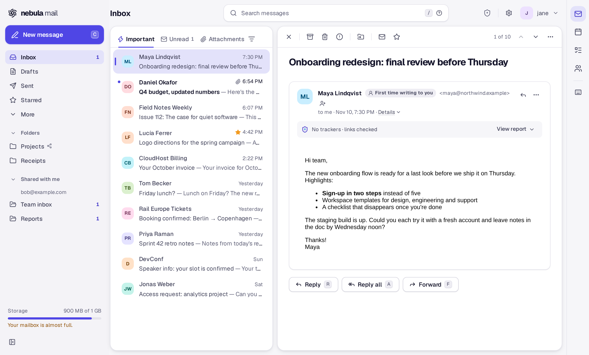
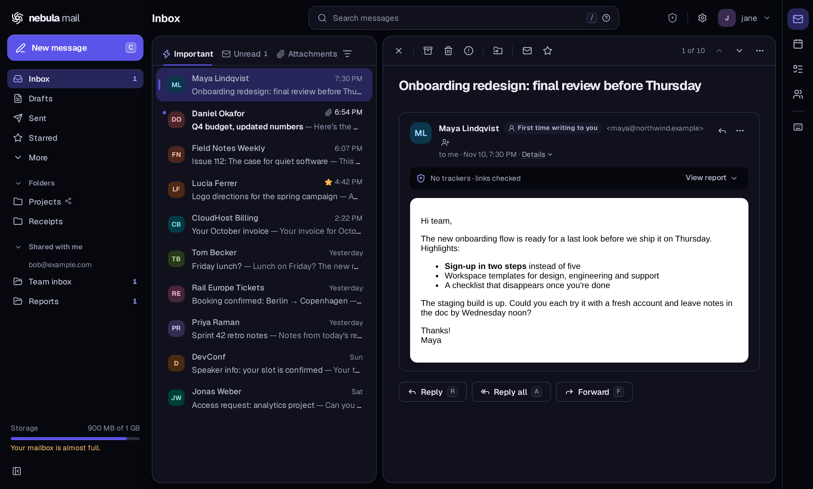
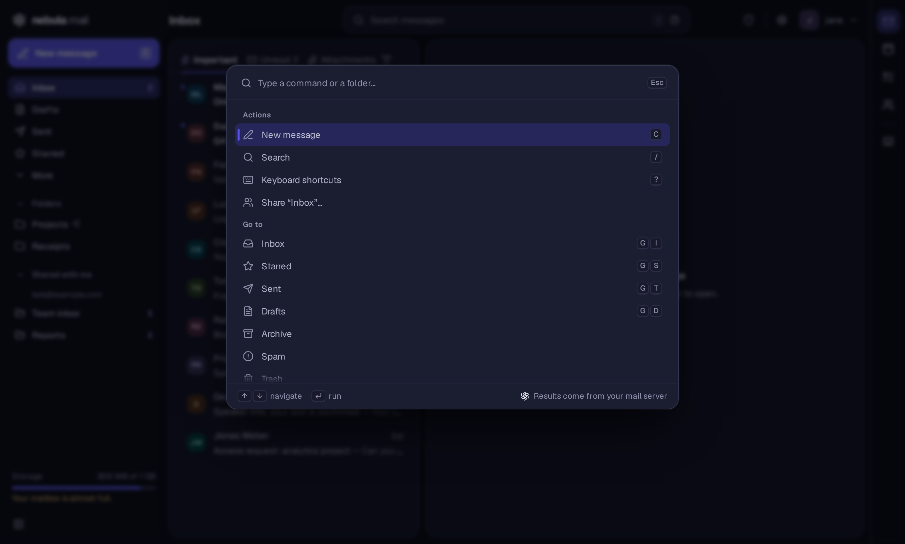
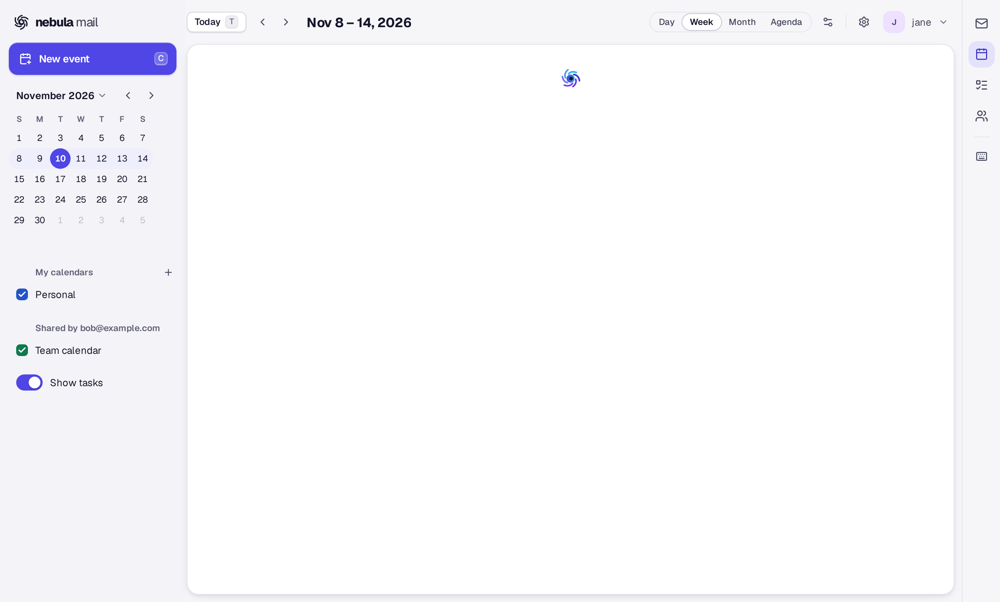
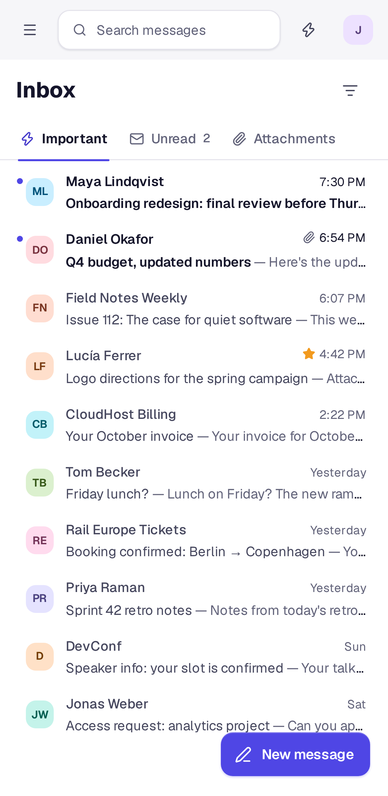

<!-- SPDX-FileCopyrightText: 2026 Nebula Mail contributors -->
<!-- SPDX-License-Identifier: AGPL-3.0-only -->

<div align="center">

# Nebula Mail

**A modern, fast and private nebulamail. Built for [Stalwart](https://stalw.art), works with any mail server.**

Mail, calendar, contacts and tasks in one app that feels like a native one: keyboard-first, with a command palette, dark mode and a mobile layout. Your privacy comes first, and nothing in it can be turned off at the cost of your security.

[Features](#features) · [Privacy](#privacy-by-default) · [Security](#security-you-cant-turn-off) · [Standards](#built-on-open-standards) · [Get started](#get-started) · [Development](#development)

</div>

<p align="center">
  
</p>

---

## Why Nebula Mail

- **Fast and focused.** A compact interface inspired by the best keyboard-driven mail apps: `j`/`k` to move, `e` to archive, `⌘K` for everything else. Conversations, a split view, virtual lists that stay smooth with thousands of emails, and live updates pushed by the server.
- **Private by default.** Remote images are blocked until you allow them, and even then they come through a proxy so senders never see your IP address. Tracking pixels are removed and links are cleaned, always. No analytics or telemetry of any kind.
- **Secure by design.** Every email is sanitized and shown in its own locked-down frame, under a strict Content Security Policy and Trusted Types. The security layers are always on: the settings never let you switch them off.
- **Made for Stalwart, open to everyone.** It speaks [JMAP](https://jmap.io) natively, the modern standard that [Stalwart](https://stalw.art) implements. For any other server (Dovecot, Postfix, your hosting provider, Gmail with an app password, Fastmail, iCloud, Nextcloud…), an optional bridge written in Rust translates IMAP, SMTP, CalDAV, CardDAV and ManageSieve into JMAP.
- **Everything in one place.** Mail, calendar with invitations, contacts, tasks, filters and an out-of-office reply, without plugins.
- **Open standards, done right.** Every protocol behaviour follows its RFC, and the code cites the section. When we deviate (for privacy or security) the reason is written down.

> **Status:** pre-release. Mail, calendar, contacts, tasks, filters and the bridge are complete and tested against real servers; the first versioned release is on its way.

## Features

<table>
  <tr>
    <td width="50%"></td>
    <td width="50%"></td>
  </tr>
  <tr>
    <td width="50%"></td>
    <td width="50%" align="center"></td>
  </tr>
</table>

### Mail

- **Conversations** with a split view (list beside the reader) or a full-width reader, and threads read as stacked cards with the unread and newest ones open.
- **Keyboard-first:** shortcuts for every action and a **command palette** (`⌘K` / `Ctrl+K`) to jump to folders, emails and actions.
- **Live updates** over JMAP push (EventSource), with incremental sync: new mail appears without reloading.
- **Powerful search** with operators in English and Spanish: `from:`, `to:`, `cc:`, `subject:`, `has:attachment`, `is:unread`, `is:starred`, `before:`, `after:` and quoted phrases.
- **Rich composer:** fonts and sizes, formatting, text direction, lists, links, an emoji picker, inline images and pasted screenshots, or plain text mode. Defaults for font, size and format.
- **Drafts saved as you type**, with a local copy if the connection drops, so nothing you write is lost.
- **Undo send** that really works: the server holds the message, so undo cancels it there, and closing the tab still sends it.
- **Scheduled send** ("This afternoon", "Tomorrow morning", "Monday morning" or any date and time), with a **Scheduled** view to reschedule or cancel.
- **Identities and signatures**, with each identity's Reply-To and Bcc.
- **Attachments** with upload progress and size limits shown before you hit them; quoted images and inline (`cid:`) images kept when you reply or forward.
- **Recipient autocomplete** from your contacts and recent recipients.
- **Spam / Not spam** that trains the server's filter.
- **Unsubscribe** button (List-Unsubscribe), including one-click unsubscribe after you confirm it, and only for emails that pass DKIM.
- **Read receipts** (MDN) on your terms: never, ask, or always. Request one when you send.
- **Delivery status** per recipient: delivered, bounced (with the server's reply), queued or read.
- **"Verified sender"** badge from the server's own Authentication-Results.
- **Shared and delegated folders**: see folders others share with you, share yours, and answer from the shared account.
- **Storage bar** with your quota.
- **View original**, download as `.eml`, view as plain text, and **print** the sanitized email.
- **Server alerts** (IMAP `[ALERT]`) shown as the standards require.
- **Notifications** for new mail, with the tab open or closed (Web Push).

### Calendar

- Day, week, month and agenda views; drag to create; colors per calendar; time zones done right (each event keeps its own, and the organizer's time is shown when it differs).
- Repeating events (daily, weekdays, weekly, monthly, yearly), with "this event" or "all events" when you change or delete one.
- **Invitations inside your mail:** accept, decline or maybe, add a note, or **propose a new time**. Organizers get updates and cancellations sent for them. Answers to a single occurrence work too.
- **Free/busy** of the people you invite.
- **Reminders** with snooze, also when the tab is closed (Web Push); default reminders and time zone per calendar.
- **Share calendars** (free/busy only, view, edit or manage) and see calendars shared with you.
- Birthdays from your contacts, also with non-Gregorian calendars.

### Contacts

- Search, groups, photos, birthdays without a year, notes, addresses, phones and more (JSContact).
- What other apps saved and Nebula Mail doesn't show is **kept untouched** when you edit a contact.
- **vCard import and export** (import always asks first).
- **Share address books** with view, edit or manage rights.

### Tasks

- Lists, **Today**, **Upcoming**, **All** and **Done** views, subtasks (drag a task onto another), manual order, priorities, notes and due dates with or without a time.
- Repeating tasks, reminders ("on the day at 9:00", "1 day before"…), and **task assignment** to other people.
- Fully keyboard-driven, and optionally shown in the calendar.
- Stored as standard calendar tasks (VTODO), so they sync with your phone and other apps.

### Filters and out-of-office

- **Visual filter editor** (conditions on sender, recipients, subject, body, any header, size or attachments; move, copy, mark as read, star, tag, forward, reject, discard or stop) that writes a clean Sieve script.
- **Your own Sieve scripts** too, with syntax highlighting, validation and several scripts to switch between.
- **Out-of-office reply** with dates, which pauses and restores your active filters when needed.

### Everywhere

- **Responsive and touch-friendly:** 44 px touch targets, mobile actions for every email, and an installable **PWA**.
- **Light and dark themes** and a design system of its own (no generic UI kit).
- **Settings synced across devices**, stored on your own mail server.
- **English and Spanish**, with right-to-left text handled in emails, names and the composer.
- **Accessible:** proper roles and names, focus management, and every feature reachable from the keyboard.

## Privacy by default

Privacy is configurable; you decide how much to trade for convenience, and the defaults protect you.

| What | Default | Options |
| --- | --- | --- |
| Remote images | Ask | Never · Ask · Always from trusted senders · Always |
| How images load | Through the image proxy (senders never see your IP) | Direct, if the administrator allows it |
| Tracking pixels | Removed, even when images are shown | Tracker list (MailTrackerBlocker) and spy-pixel rules, each one switchable |
| Link tracking parameters (`utm_*`, `fbclid`…) | Removed | On / off |
| Opening links | Confirm, showing the real destination | Always · Only suspicious ones · Never |
| Read receipts | Ask | Never · Ask · Always |
| Privacy report | Shown: "N trackers blocked", per service | Show / hide |

More:

- **Image proxy with zero storage required.** It fetches all of an email's images at once (so the sender can't tell when you opened it), or caches them, or **downloads them when the email arrives** through a Stalwart hook, before you ever open it. It runs on Node, Bun, Deno, Cloudflare Workers or Vercel, with disk or S3-compatible storage.
- **No telemetry, no analytics, no third-party requests.** Fonts and icons ship with the app.
- **Tokens never touch `localStorage`.** In the server version, the refresh token lives encrypted in an `HttpOnly` cookie; in the full-proxy mode the browser never sees a token at all.
- Administrators set the defaults and can lock options; users change whatever the administrator allows.

## Security you can't turn off

Email is the most common way in for attackers, so the parts that stop an email from running code or reading other emails are always on:

- **Battle-tested sanitizer:** Proton Mail's sanitizer (DOMPurify-based), unmodified, plus our own stricter pass that removes forms, `base`, `meta` and `link` (no fake login forms, no CSS keyloggers) and anything that would load content before you allow it.
- **One sandboxed frame per email:** no scripts, forms, popups or navigation, its own Content Security Policy, `no-referrer`, and no way for one email's CSS to read another.
- **Strict CSP** with per-request nonces and `strict-dynamic`, **Trusted Types** enforced, and `frame-ancestors 'none'`.
- **Safe links:** only `http`, `https` and `mailto` open; a dialog warns when the text says one domain and the link goes to another, or when a domain uses look-alike characters (punycode). Sender domains with international characters are labelled.
- **SSRF protection as a first-class library** (`net-guard`, in TypeScript and Rust): every outgoing request checks each resolved IP, pins it, follows redirects one by one and limits sizes and time. A suite of attack vectors runs in CI against every implementation.
- **OAuth 2.1** with PKCE, refresh token rotation and revocation on sign-out; CSRF checks on everything that changes state.
- **Rust bridge with no `unsafe` code**, strictly typed, with credentials encrypted at rest.
- **Reviewed against real-world CVEs of other mail clients** (ReDoS, forged calendar replies, local-network images, homograph senders…) and audited, with hostile-email and SSRF corpora in the test suite.
- **Careful supply chain:** few dependencies, a minimum release age for new versions, vendored code kept unmodified with its license and commit. Releases are built to be reproducible and signed, with an SBOM.

Found a vulnerability? Please report it privately: see [SECURITY.md](SECURITY.md).

## Built on open standards

Nebula Mail talks to your server only through open standards, and follows them closely. Among others:

| Area | Standards |
| --- | --- |
| Mail | JMAP Core and Mail (RFC 8620, RFC 8621), Quotas (RFC 9425), Sharing (RFC 9670), Web Push (RFC 8030, RFC 8291, RFC 8292) |
| Calendar and tasks | JMAP Calendars, JSCalendar (RFC 8984), iCalendar (RFC 5545), iTIP / iMIP (RFC 5546, RFC 6047) |
| Contacts | JMAP Contacts (RFC 9610), JSContact (RFC 9553), vCard (RFC 6350) |
| Filters | JMAP Sieve (RFC 9661), Sieve (RFC 5228) and its extensions, including `mailboxid` (RFC 9042) |
| Sending | FUTURERELEASE (RFC 4865) for undo and scheduled send, MDN (RFC 8098), DSN (RFC 3461), one-click unsubscribe (RFC 8058) |
| Sign-in | OAuth 2.1 with PKCE, Authorization Server Metadata (RFC 8414), issuer identification (RFC 9207), token revocation (RFC 7009) |
| Bridge | IMAP4rev2 / IMAP4rev1 (RFC 9051, RFC 3501) with CONDSTORE/QRESYNC (RFC 7162) and OBJECTID (RFC 8474), SMTP (RFC 5321), CalDAV (RFC 4791), CardDAV (RFC 6352), ManageSieve (RFC 5804) |

## Works with your mail server

| Server | How |
| --- | --- |
| **Stalwart** | Directly over JMAP. No extra software. |
| **Any IMAP + SMTP server** (Dovecot, Postfix, hosting providers, Gmail with an app password…) | Through the bridge |
| **Calendars and contacts** on Stalwart, Nextcloud, Radicale, Baïkal / sabre/dav, Fastmail or iCloud | Through the bridge (CalDAV / CardDAV) |
| **Filters** on Dovecot (Pigeonhole) or any ManageSieve server | Through the bridge |

The bridge is a single static binary. Users sign in with their usual mail login, and server addresses only come from the administrator's configuration. It also serves any other JMAP client.

## Get started

| You want… | Read |
| --- | --- |
| The **server version** (recommended): the web app with its small backend for sign-in, image proxy and one-click unsubscribe. No database. | [docs/getting-started.md](docs/getting-started.md) |
| The same, but the browser never receives a mail token and your mail server stays on a private network | [docs/jmap-proxy.md](docs/jmap-proxy.md) |
| A zip that **Stalwart serves by itself**, with no server of ours at all | [docs/static.md](docs/static.md) |
| A mail server other than Stalwart (IMAP, SMTP, CalDAV, CardDAV, ManageSieve) | [docs/bridge.md](docs/bridge.md) |
| To know what the "Verified sender" badge means and when it can be wrong | [docs/verified-sender.md](docs/verified-sender.md) |
| Privacy-preserving remote images (the image proxy) | [packages/image-proxy/README.md](packages/image-proxy/README.md) |

## Project layout

| Path | What | License |
| --- | --- | --- |
| `apps/web` | The web app (TanStack Start, React 19): UI, backend and image proxy routes | AGPL-3.0-only |
| `packages/ui` | Design system: StyleX tokens + Base UI | AGPL-3.0-only |
| `packages/mail-render` | Safe email HTML rendering | AGPL-3.0-only |
| `packages/image-proxy` | Hosting-agnostic image proxy | AGPL-3.0-only |
| `packages/jmap-client` | Typed JMAP client | MIT OR Apache-2.0 |
| `packages/net-guard` | SSRF protection | MIT OR Apache-2.0 |
| `bridge/` | Rust bridge for non-JMAP servers | AGPL-3.0-only (libraries MIT OR Apache-2.0) |
| `security/` | SSRF vectors and hostile email corpus |  |
| `docker/` | Local mail servers for development ([docker/README.md](docker/README.md)) |  |

## Development

Requirements: [Bun](https://bun.sh), Rust (version pinned in `bridge/rust-toolchain.toml`), and Docker only when you need a local mail server.

```sh
bun install
bun run dev          # http://localhost:3001
bun run check        # lint and format (Ultracite: oxlint + oxfmt)
bun run fix          # apply automatic fixes
bun run check-types
bun run test

cd bridge
cargo clippy --all-targets -- -D warnings
cargo test
```

For a local Stalwart with test accounts and sample data, see [docker/README.md](docker/README.md). The screenshots above come from `bun run screenshots` in `apps/web` (a demo mailbox on the test server; no real account). Contributions are welcome: read [CONTRIBUTING.md](CONTRIBUTING.md) first.

## License

The app and the bridge are **AGPL-3.0-only**; the reusable libraries (`jmap-client`, `net-guard` and the bridge's library crates) are **MIT OR Apache-2.0**. Every file carries an SPDX header ([REUSE](https://reuse.software)); license texts are in `LICENSES/`.

Nebula Mail is an independent project, not affiliated with Stalwart Labs.

---

<p align="center">Made by <a href="https://helixnebula.tech">HelixNebula</a>.</p>
